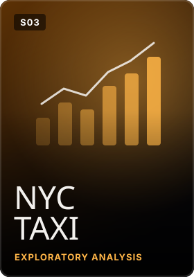
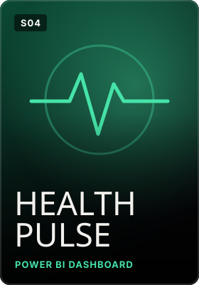
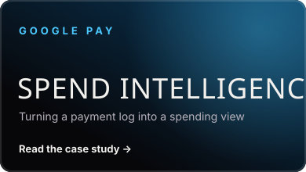
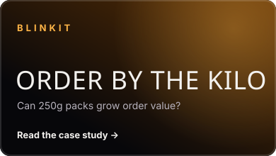
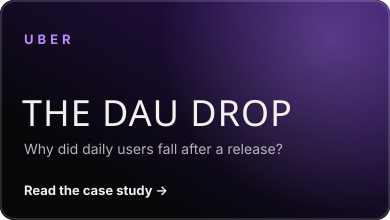

  <a href="https://shubham-kanauji-pm.vercel.app"><b>▶ Watch the portfolio</b></a> &nbsp;·&nbsp;
  <a href="https://youtu.be/B1Qq79klDH8">Trailer</a> &nbsp;·&nbsp;
  <a href="https://linkedin.com/in/foxsalsa">LinkedIn</a> &nbsp;·&nbsp;
  <a href="mailto:shub.ds.ai@gmail.com">Email</a>

I turn messy problems into shipped products, across AI, ML evaluation and 0→1 delivery.

  
  
  
  

Select a poster to open the code. Promise Keeper is also <a href="https://promise-keeper-omega.vercel.app">live</a> (access by request).

  
  
  

| Season | Role | Where | Aired |
|:--:|:--|:--|:--|
| **03** | Product Lead, Google Shopping | HCLTech (Google Onsite) | Apr 2025 – Apr 2026 |
| **02** | Program Lead, DfE | AECOM | Sep 2022 – Apr 2025 |
| **01** | Product Manager, AI Product (Contract) | The Call Centre Doctor | May 2020 – Aug 2022 |

| Playing | The crew |
|:--|:--|
| **Product** | Strategy, 0→1, roadmapping, PRDs, RICE, GTM |
| **Research** | User interviews, journey mapping, prototyping, A/B testing |
| **Data** | SQL, Python, BigQuery, Power BI, Tableau, Google Analytics |
| **AI** | LLMs, RAG, agentic AI, prompt engineering, MCP |

| Issuer | Certification |
|:--|:--|
| Anthropic | Claude Certified Architect – Professional |
| Microsoft | [Fabric Data Engineer (DP-700)](https://learn.microsoft.com/en-us/users/ShubhamKanauji-8507/credentials/CA88B9BCBDE2344C) · [Power BI Data Analyst (PL-300)](https://learn.microsoft.com/en-us/users/shubhamkanauji-8507/credentials/5d1bf5f40c3c389d) |
| McKinsey | [Forward Program](https://www.credly.com/badges/be225f29-3dd9-4a76-bee3-a4685e7c3c15/public_url) |
| Scrum.org | [Professional Scrum Master I](https://www.credly.com/badges/50b96376-f706-4375-a00d-31631a4511a3/public_url) |
| Google | [Project Management](https://www.coursera.org/account/accomplishments/specialization/WHAJ5ULXY79V) · [AI Essentials](https://www.coursera.org/account/accomplishments/verify/BBE389A5HJGS) |
| Atlassian | [Agile with Jira](https://www.coursera.org/account/accomplishments/verify/1J9STESK6QXB) |
| HackerRank | [Python](https://www.hackerrank.com/certificates/iframe/89584e4e498a) · [SQL (Intermediate)](https://www.hackerrank.com/certificates/iframe/1aeb10873033) |

Education: Executive PG Programme in Data Science &amp; AI, IIIT Bangalore (2025–2027, expected) · B.Tech, GGSIPU (2016–2020)

